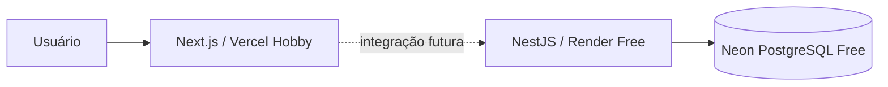

# Arquitetura de Software — Orbit

## Estratégia

Arquitetura **modular monolith** em monorepo. É uma estrutura profissional, simples de operar no início e preparada para extração futura de serviços quando houver escala real.

## Stack e evolução

### Runtime e workspace
- Node.js 24 LTS
- TypeScript
- npm workspaces
- Turborepo

### Frontend — `apps/web`
- Next.js 16 (App Router)
- React 19.3
- Tailwind CSS 4.x
- Pacote interno `@orbit/design-system`, Lucide e fontes locais.
- Formulários de acesso e dashboard demonstrativos, sem integração com a API.
- React Hook Form, Zod e TanStack Query são opções já consideradas para formulários e estado remoto. A decisão fica para quando houver integração.

### Backend — `apps/api`
- NestJS 12, ESM e Fastify, com módulos de domínio.
- `GET /api/v1/health`, CORS restrito, Helmet e rate limiting em memória.
- Validação de DTOs via `ValidationPipe`, `class-validator` e `class-transformer`.
- Readiness, endpoints de negócio e OpenAPI ficam para ciclos posteriores.

### Dados
- PostgreSQL e Drizzle com migrations SQL versionadas e driver `pg`.
- Neon PostgreSQL Free é o banco da hospedagem planejada. O banco local é opcional.
- Identidade externa, armazenamento de objetos e RLS ficam para os ciclos correspondentes.
- pgvector para embeddings quando RAG for habilitado.

### Jobs e cache
- Upstash Redis ou Redis compatível em produção — pendente
- BullMQ para tarefas assíncronas pesadas — pendente
- no desenvolvimento inicial, jobs podem rodar inline atrás de uma interface de queue

### IA (planejada)
- `AiProvider` abstrato dentro da API
- primeiro provider: OpenAI API
- structured outputs para respostas consumidas pelo sistema
- embeddings + pgvector para RAG de materiais
- prompts versionados no repositório
- nenhuma chave de IA no cliente

### Observabilidade
- OpenTelemetry — plano de instrumentação a definir
- Sentry (front e API) — plano a definir
- logs estruturados (Pino) — já implementado
- correlation/request id — já implementado

### Testes
- `node:test`, injeção HTTP do Fastify e dublês de persistência na API.
- Integração com Postgres real, Playwright e Testcontainers permanecem no planejamento.

### Hospedagem e CI
- Hospedagem pendente de provisionamento e smoke. Consulte o [runbook](DEPLOYMENT.md).
- GitHub Actions permanece no planejamento.

## Topologia de hospedagem planejada



## Monorepo

```text
orbit/
├─ apps/
│  ├─ web/          Next.js 16, App Router, Tailwind CSS 4
│  ├─ api/          NestJS 12, Fastify, ESM
│  └─ worker/       # só quando fila real for ativada
├─ packages/
│  ├─ contracts/           # schemas e DTOs compartilhados
│  ├─ design-system/       # tokens + componentes Orbit
│  ├─ config-eslint/
│  ├─ config-typescript/
│  └─ observability/     # pendente instrumentação
├─ docs/
├─ .github/workflows/     # CI planejado
├─ package.json            # npm workspaces, engines Node >=24.15.0 <25, npm >=10.9 <12
├─ package-lock.json
└─ turbo.json
```

## Módulos de domínio previstos

A estrutura abaixo representa a evolução planejada. Veja [o estado atual da API](API.md).

```text
src/modules/
├─ auth/
├─ users/
├─ semesters/
├─ subjects/
├─ schedules/
├─ tasks/
├─ assessments/
├─ focus/
├─ study-plans/
├─ materials/
├─ ai/
├─ analytics/
└─ notifications/
```

Cada módulo deve conter seu domínio, application services/use cases, adapters/repositories e controllers. Não importe internals de outro módulo; use serviços públicos, eventos ou contratos.

## Fluxo de autenticação planejado

1. A web inicia a sessão com o serviço de identidade a selecionar.
2. A API valida a identidade em cada rota protegida e resolve o UUID interno associado ao emissor e ao identificador externo.
3. Consultas e mutações são limitadas ao usuário identificado. RLS será uma barreira adicional em tabelas de usuário, com identidade restrita à transação e papel de runtime sem bypass.

## Princípios arquiteturais

- Controller fino, regra em service/use case.
- Domínio não conhece HTTP nem SDK de IA.
- Infraestrutura é substituível por adapters.
- Eventos internos para efeitos colaterais.
- Idempotência em criação via jobs/webhooks.
- UTC no banco; timezone do usuário na apresentação.
- Soft delete somente onde houver valor real; preferir histórico/audit quando necessário.
- Nunca armazenar segredo no cliente.

## Evolução futura

Somente extrair um módulo para serviço independente se houver pelo menos um motivador concreto: escala separada, limites de segurança, ciclo de deploy próprio ou equipe dedicada. Candidatos naturais: AI/worker e notifications.
